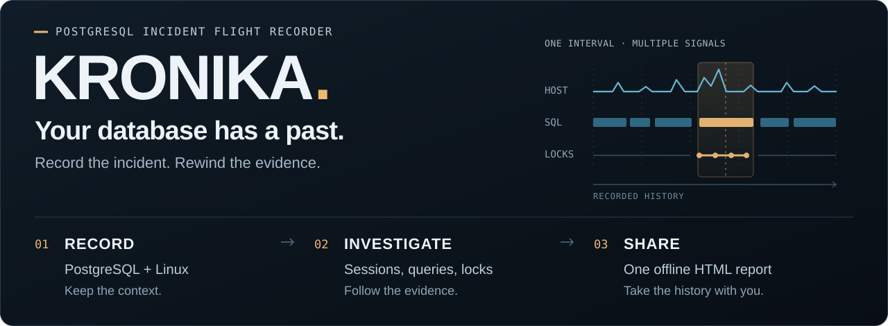
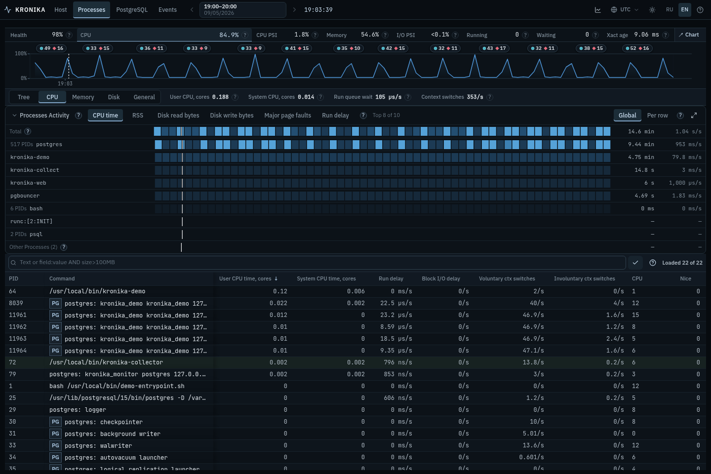
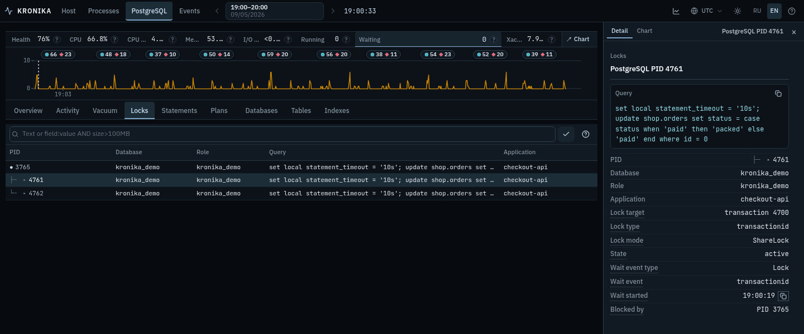
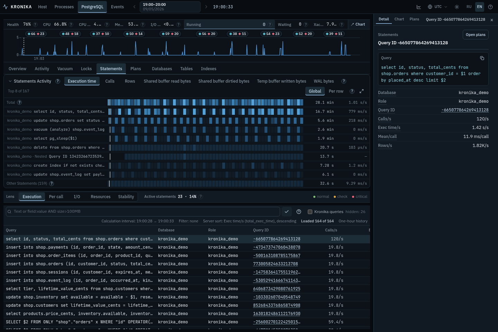
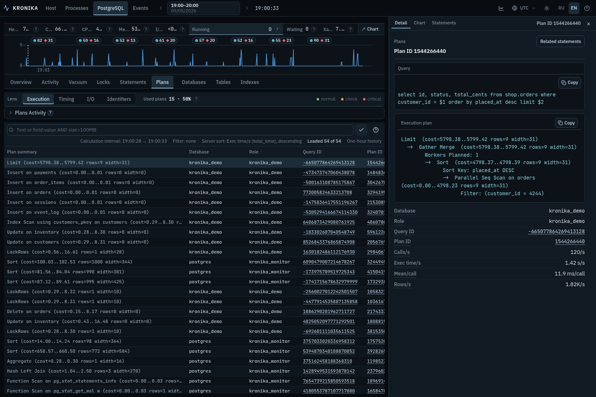
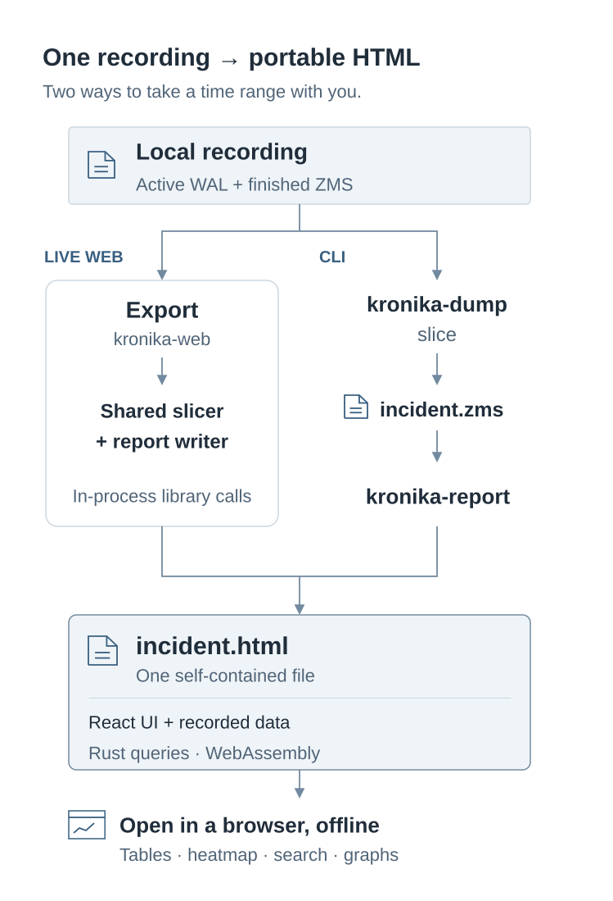
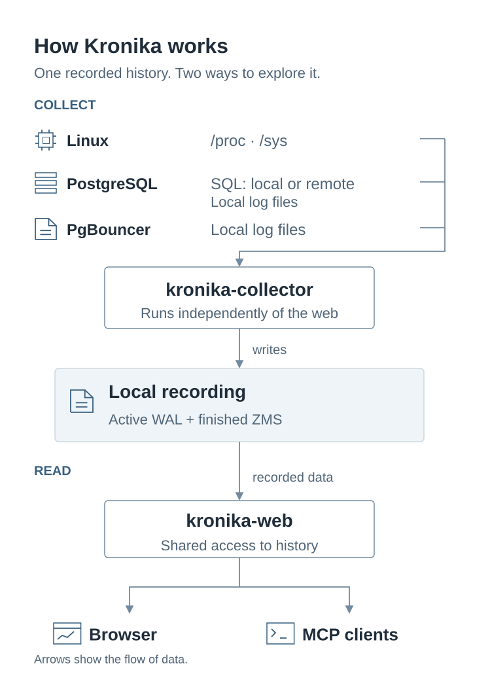

<p align="center">
  
</p>

<h1 align="center">Kronika</h1>
<p align="center"><strong>A flight recorder for PostgreSQL and Linux.</strong><br>
Record what happened. Investigate a moment. Take the evidence with you.</p>
<p align="center">
  <a href="https://pgtoolz.github.io/Kronika/"><strong>Open the interactive demo →</strong></a> ·
  <a href="#install-and-run">Install</a> ·
  <a href="docs/operator-guide.md">Operator guide</a> ·
  <a href="README.ru.md">Русский</a>
</p>

---

Kronika records Linux metrics, PostgreSQL statistics, query plans and events
from PostgreSQL/PgBouncer logs. Choose a recorded hour, move the time cursor,
and inspect the processes, queries and locks around it. Export an interval as
**one interactive HTML file that works offline**.

## Revisit the moment

[](https://pgtoolz.github.io/Kronika/reports/kronika-v1.2.0.html?at=1788635019201666&lens=cpu)

*An actual Kronika demo recording, 5 September 2026: the whole-hour activity map
above, the selected process snapshot below. Click the image to explore that moment.*

**Try the 1.2.4 recording:**
[Processes](https://pgtoolz.github.io/Kronika/reports/kronika-v1.2.4.html?at=1789984000000000&view=processes) ·
[Statements](https://pgtoolz.github.io/Kronika/reports/kronika-v1.2.4.html?at=1789984000000000&view=pg.statements) ·
[Plans](https://pgtoolz.github.io/Kronika/reports/kronika-v1.2.4.html?at=1789984000000000&view=pg.plans) ·
[Host](https://pgtoolz.github.io/Kronika/reports/kronika-v1.2.4.html?at=1789984000000000&view=host) ·
[Events](https://pgtoolz.github.io/Kronika/reports/kronika-v1.2.4.html?at=1789984000000000&view=events)

*21 September 2026, 08:59:46–09:59:46 UTC. No installation needed.*

| Record | Investigate | Share |
| :--- | :--- | :--- |
| Linux + PostgreSQL on the same host, or PostgreSQL alone on a local or remote server. | Resource use, SQL, plans, waits and blocking chains, with recorded context. | A self-contained report: interface and data together, no running Kronika server needed. |

> Start the collector **before** you need the history. Kronika works with recorded
> samples and events, not a replay of every SQL execution. Statements and plans
> require `pg_stat_statements` and `pg_store_plans`, respectively;
> [source setup and permissions](INSTALL.md#5-postgresql) determine what is available.


## One incident. Follow the evidence.

In the recorded demo, two `checkout-api` sessions are waiting on a transaction.
The root holder is **PID 3765**, sitting **`idle in transaction`**.

[](https://pgtoolz.github.io/Kronika/reports/kronika-v1.2.0.html?at=1788634833931637&view=pg.locks)

1. **Find the blocker.** In **Locks**, inspect the waiting row: blocker PIDs,
   `ShareLock`, transaction `4700`, and backend context.
2. **Keep the time, change the view.** Open **Activity** at the same cursor and
   filter `pid:4761` to inspect the session and its recorded durations.
3. **Read the event.** Open **Events** for the recorded lock-wait message,
   duration and holder context.

[Walk through this exact case →](docs/operator-guide.md#4-blocker-chain-and-backend-state)
The guide also follows host/container limits, process CPU and a SQL statement
through to its stored plan. These are recorded demo examples, not production claims.

<details>
<summary><b>More evidence: from a statement to its recorded execution plan</b></summary>

### The query

Calls, execution time, I/O and SQL text for a recorded interval. Use **Open plans**
to follow the selected statement.

[](https://pgtoolz.github.io/Kronika/reports/kronika-v1.2.0.html?at=1788634833931637&view=pg.statements)

### The plan

Inspect the stored plan alongside its SQL; **Related statements** takes you back.

[](https://pgtoolz.github.io/Kronika/reports/kronika-v1.2.0.html?at=1788634833931637&view=pg.plans)

[Follow the statement-and-plan walkthrough →](docs/operator-guide.md#3-statement-interval-and-stored-plan)

</details>

<a id="portable-html-export"></a>

## The investigation fits in one file

**Export → choose an interval → download HTML → open in a browser.**

Tables, search and charts travel with the data. Review a recorded incident
offline or pass the same evidence to a teammate without giving them access
to the monitored host or running a Kronika server.

| Live access | Portable evidence |
| :--- | :--- |
| `kronika-web` reads the collector's recording and serves the browser, HTTP API and MCP. | Exported HTML embeds the interface and selected interval’s data; it needs neither a server nor a network connection. |

> **Share deliberately:** reports include all recorded sections in the selected interval,
> which can contain SQL, plans, log messages and process command lines. The exported file has no sign-in
> protection. Review its contents before sharing.

<details>
<summary><b>See the export pipeline: web → HTML, or recording → dump → report</b></summary>

<picture>
  <source media="(prefers-color-scheme: dark)" srcset="docs/images/report-export-dark.svg">
  
</picture>

[kronika-dump](bins/kronika-dump/README.md) extracts an interval into a standalone
ZMS recording. [kronika-report](bins/kronika-report/README.md) converts it into HTML.
See [export controls and limits](docs/features.md#export).

</details>

## Install and run

[Install Kronika 1.2.4](INSTALL.md) from a [Linux release archive](docs/releases.md#download),
or [build from source](docs/build.md).

Choose `local` to record Linux and, optionally, PostgreSQL in the same VM or pod.
Choose `postgresql` for a remote server or when you only need database metrics.

### Linux and optional PostgreSQL

Create a private recording directory, then start collecting Linux metrics:

```sh
sudo install -d -m 0700 /var/lib/kronika

sudo /usr/local/bin/kronika-collector \
  --storage-dir /var/lib/kronika
```

<a id="linux-and-postgresql"></a>
For PostgreSQL on the collector machine, supply its connection string with
`--pg-dsn` when starting collector. Use a PostgreSQL account with the
[monitoring privileges](INSTALL.md#5-postgresql).

```sh
sudo /usr/local/bin/kronika-collector \
  --storage-dir /var/lib/kronika \
  --pg-dsn 'host=127.0.0.1 port=5432 user=kronika_monitor password=replace-with-password dbname=postgres sslmode=disable'
```

In this default `local` mode, the connection also discovers the current
PostgreSQL log file. If that file is readable on the collector host, `--pg-log`
is not needed.

Leave `--postgres-effective-cpus` and `KRONIKA_POSTGRES_EFFECTIVE_CPUS` unset
for this local machine: CPU capacity comes from its recorded CPU snapshots.

<details>
<summary><b>PostgreSQL only — local or remote</b></summary>

### PostgreSQL only — local or remote

```sh
sudo install -d -m 0700 -o "$(id -u)" /var/lib/kronika

/usr/local/bin/kronika-collector \
  --mode postgresql \
  --storage-dir /var/lib/kronika \
  --pg-dsn 'host=pg.example.net port=5432 user=kronika_monitor password=replace-with-password dbname=postgres'
```

If the PostgreSQL CPU capacity is known, add `--postgres-effective-cpus 4`,
replacing `4` with its CPU count.
Without it, SQL metrics remain available. PostgreSQL Health is unknown.
See [collector configuration](bins/kronika-collector/README.md#remote-postgresql).

To collect from several PostgreSQL servers, run a `kronika-collector` process
for each server with its DSN and a separate storage directory. See the
[two-server example](bins/kronika-collector/README.md#several-postgresql-servers).

</details>

### View recorded data

In a second terminal, run `kronika-web` with the collector’s data directory.
The examples bind to localhost; collection continues in the first terminal.

#### For `local` mode

```sh
sudo /usr/local/bin/kronika-web --storage-dir /var/lib/kronika \
  --listen 127.0.0.1:8080
```

#### For `postgresql` mode

```sh
/usr/local/bin/kronika-web --storage-dir /var/lib/kronika \
  --listen 127.0.0.1:8080
```

Open `http://127.0.0.1:8080` on that machine. For a remote host, use an SSH
tunnel or a suitably secured reverse proxy. The server speaks plain HTTP and
has no authentication unless credentials are configured; do not expose it
unprotected to an untrusted network.

To require sign-in, add `--user kronika --password 'replace-with-a-random-password'`.
Options override their environment fallbacks; existing `KRONIKA_WEB_*` service
settings continue to work. See `kronika-web --help` for the full option list.

[Systemd setup](docs/services.md) covers running both programs as services and
changing an existing service's configuration.

<details>
<summary><b>Storage, retention and disk sizing</b></summary>

### Storage

For a PostgreSQL workload with roughly 500 tables and 3,000 indexes, estimate
**about 200 MB of compressed recordings per day**. Volume depends on collection
intervals and the number of recorded objects and distinct queries.

The default storage limit is **2 GiB** (`--retention`), including journals and
indexes. When the limit is exceeded, the collector removes the oldest finished
recordings and their indexes.

`auto` and `auto:P` instead set a used-space percentage target for the whole
backing filesystem. See [storage configuration](bins/kronika-collector/README.md#storage)
for the rotation rules and automatic mode.

</details>

## Recorded data and views

| Domain | What you can inspect | Reference |
| --- | --- | --- |
| Processes | Command, state and process number (PID), CPU use, memory and disk reads/writes, process tree and hourly activity. | [Linux metrics](docs/metrics-linux.md) |
| Host | CPU, memory, time waiting for resources (PSI), network and disks, free space and device relationships, cgroup resource limits and use. | [Linux metrics](docs/metrics-linux.md) |
| PostgreSQL sessions | Overview, Activity, Locks, Vacuum: session states and waits, blocking chains, query/transaction durations and table cleanup progress. | [PostgreSQL metrics](docs/metrics-postgresql.md) |
| Queries and plans | Statements and Plans: calls, execution/planning time, page and temporary-file reads, write-ahead log (WAL) output, SQL and plan text. | [PostgreSQL metrics](docs/metrics-postgresql.md) |
| PostgreSQL objects | Databases, Tables and Indexes: settings, size, reads and changes, maintenance and transaction ages. Grouping by database, schema and tablespace. | [PostgreSQL metrics](docs/metrics-postgresql.md) |
| Events | Grouped PostgreSQL/PgBouncer log events, occurrences, durations and recorded context, metric marks. | [Views and controls](docs/features.md) |
| Time and charts | Choose an hour and a time within it. View changes, activity maps, totals and the distribution of measurements. | [Time and calculations](docs/metrics-time.md) |


[Views and controls](docs/features.md) covers selection, grouping, search,
sorting, Inspector, charts and export.

## Collection and access

The collector writes local recordings independently of the web server.
`kronika-web` reads them for the browser, HTTP API and MCP at one address and port.
The **AI** panel provides connection settings; [MCP tools](docs/features.md#mcp)
read recorded values, ranked objects, field descriptions, events and row details.

| Source | Default interval |
| :--- | :--- |
| Processes / core Linux | 5 s / 10 s |
| PostgreSQL instance | 30 s |
| PostgreSQL activity, locks and vacuum | 10 s; 5 s during detected lock waits |
| Statements, plans, tables and indexes | 300 s |

[Collector configuration](bins/kronika-collector/README.md) defines source
selection, intervals, access permissions and removal of old recordings.

<details>
<summary><b>Architecture: sources → collector → recording → browser and MCP</b></summary>

<picture>
  <source media="(prefers-color-scheme: dark)" srcset="docs/images/architecture-dark.svg">
  
</picture>

</details>

## Documentation

- Setup: [Install](INSTALL.md) · [Archives and CI](docs/releases.md) · [Services](docs/services.md) · [Storage failures](docs/storage-recovery.md) · [Source build](docs/build.md)
- Reference: [Controls](docs/features.md) · [Time](docs/metrics-time.md) · [Linux](docs/metrics-linux.md) · [PostgreSQL](docs/metrics-postgresql.md) · [MCP](docs/mcp-clients.md)
- Programs: [Collector](bins/kronika-collector/README.md) · [Web](bins/kronika-web/README.md) · [Dump](bins/kronika-dump/README.md) · [Report](bins/kronika-report/README.md)
- Recorded fields: [Linux](docs/type-registry/os.md) · [PostgreSQL metrics](docs/type-registry/postgresql-metrics.md) · [PostgreSQL events](docs/type-registry/postgresql.md) · [PgBouncer events](docs/type-registry/pgbouncer.md)
- Development: [Libraries](crates/README.md) · [Segment format](crates/kronika-format/README.md) · [Development demo](bins/kronika-demo/README.md)

[MIT License](LICENSE).
