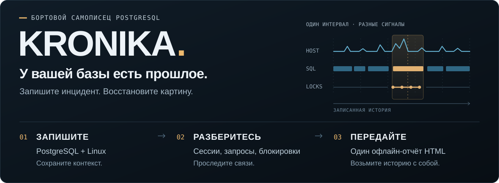
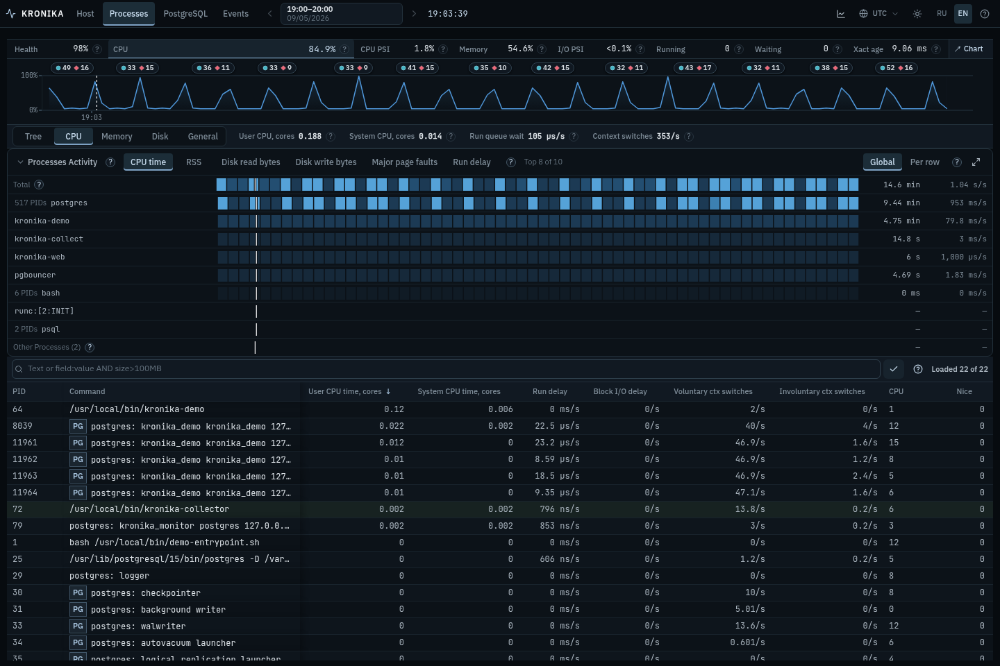
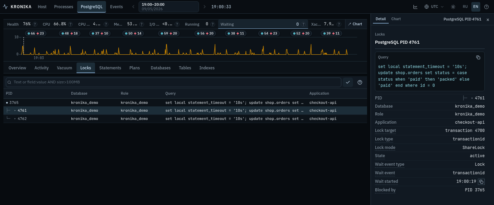
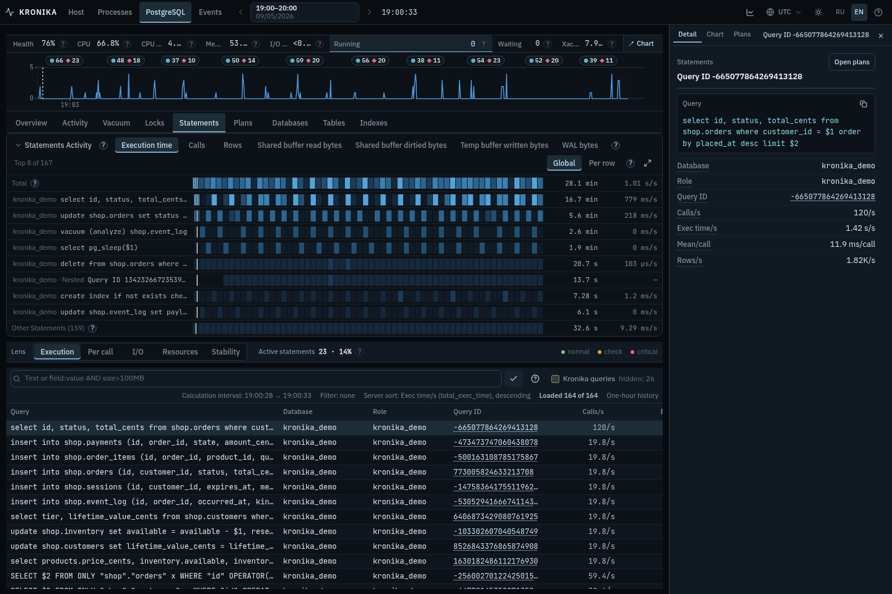
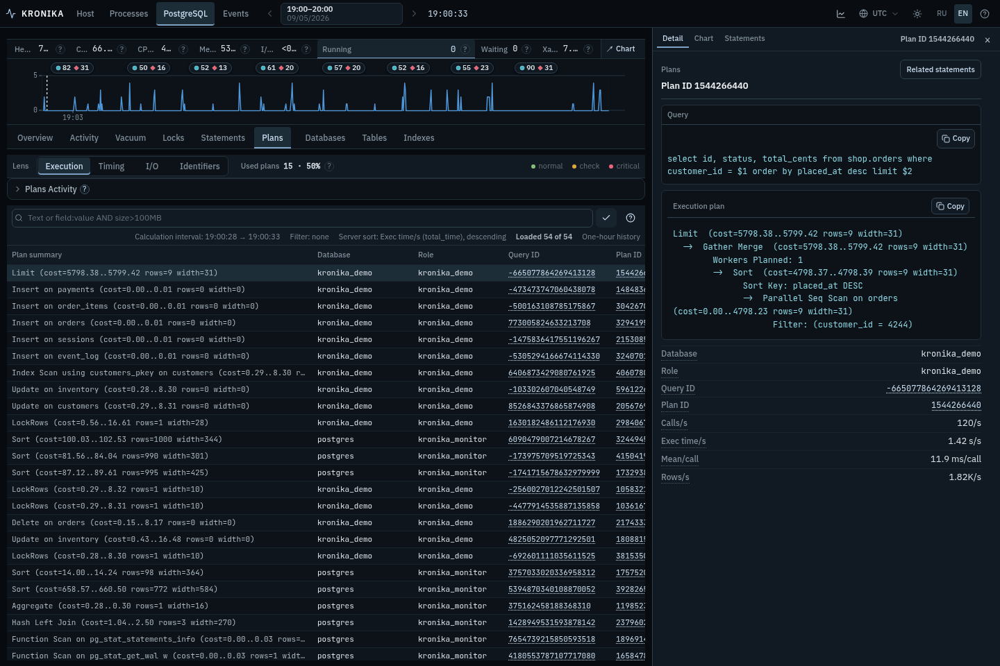
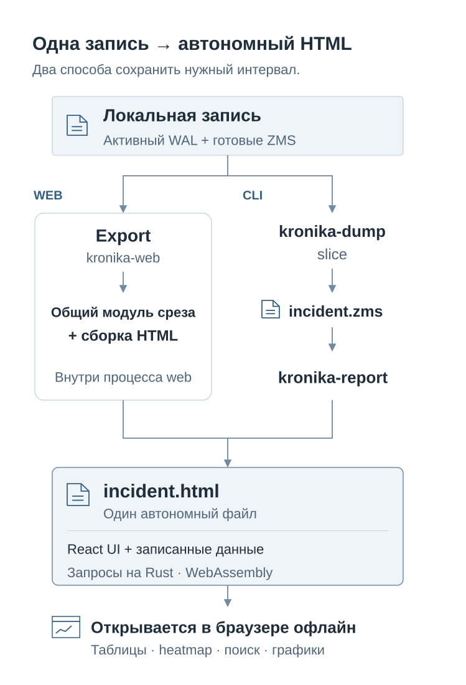
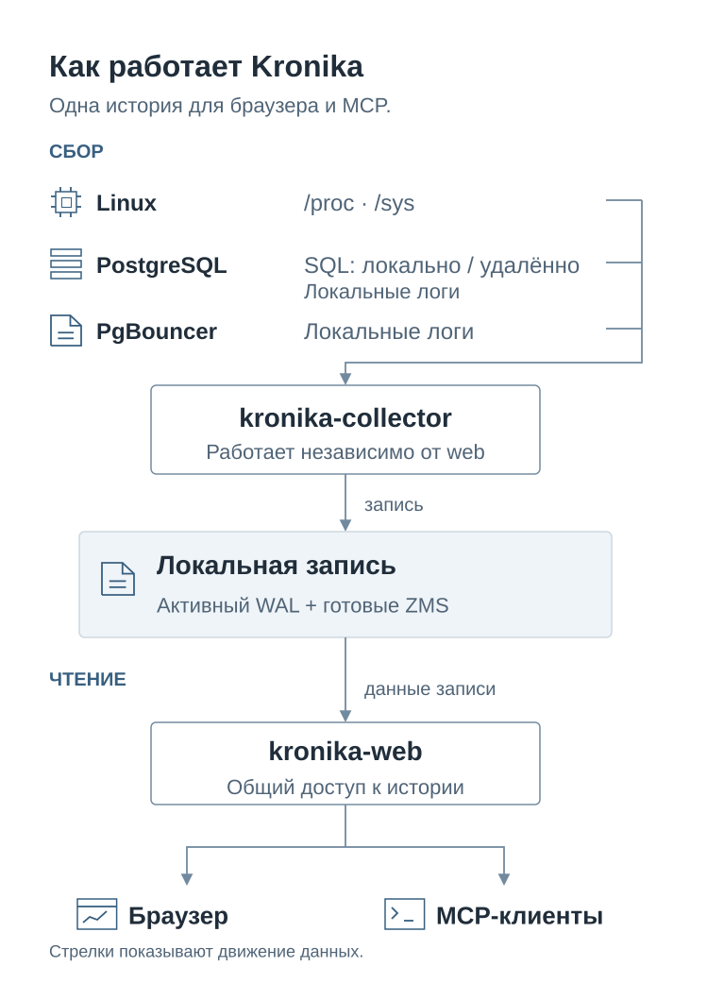

<p align="center">
  
</p>

<h1 align="center">Kronika</h1>
<p align="center"><strong>Бортовой самописец для PostgreSQL и Linux.</strong><br>
Запишите происходящее. Исследуйте нужный момент. Заберите данные с собой.</p>
<p align="center">
  <a href="https://pgtoolz.github.io/Kronika/"><strong>Открыть интерактивный пример →</strong></a> ·
  <a href="#установка-и-запуск">Установка</a> ·
  <a href="docs/operator-guide.ru.md">Руководство оператора</a> ·
  <a href="README.md">English</a>
</p>

---

Kronika сохраняет метрики Linux, статистику PostgreSQL, планы запросов и события
из журналов PostgreSQL/PgBouncer. Выберите записанный час, передвиньте курсор
времени и изучите процессы, запросы и блокировки рядом с этим моментом.
Нужный интервал можно сохранить в **один интерактивный HTML-файл, работающий офлайн**.

## Вернитесь к нужному моменту

[](https://pgtoolz.github.io/Kronika/reports/kronika-v1.2.0.html?at=1788635019201666&lens=cpu)

*Настоящая запись демонстрационной нагрузки Kronika за 5 сентября 2026 года:
сверху — активность за час, снизу — процессы в выбранный момент.
Нажмите на изображение, чтобы открыть этот момент в интерфейсе.*

**Попробуйте запись версии 1.2.4:**
[Processes](https://pgtoolz.github.io/Kronika/reports/kronika-v1.2.4.html?at=1789984000000000&view=processes) ·
[Statements](https://pgtoolz.github.io/Kronika/reports/kronika-v1.2.4.html?at=1789984000000000&view=pg.statements) ·
[Plans](https://pgtoolz.github.io/Kronika/reports/kronika-v1.2.4.html?at=1789984000000000&view=pg.plans) ·
[Host](https://pgtoolz.github.io/Kronika/reports/kronika-v1.2.4.html?at=1789984000000000&view=host) ·
[Events](https://pgtoolz.github.io/Kronika/reports/kronika-v1.2.4.html?at=1789984000000000&view=events)

*21 сентября 2026 года, 08:59:46–09:59:46 UTC. Установка не нужна.*

| Запишите | Исследуйте | Поделитесь |
| :--- | :--- | :--- |
| Linux и PostgreSQL на одной машине или только PostgreSQL с локального либо удалённого сервера. | Ресурсы, SQL, планы, ожидания и цепочки блокировок вместе с записанным контекстом. | Самодостаточный отчёт: интерфейс и данные в одном файле, без работающего сервера Kronika. |

> Запустите сборщик **заранее**. Kronika работает с записанными измерениями
> и событиями, а не воспроизводит каждое выполнение SQL. Для Statements нужен
> `pg_stat_statements`, для Plans — `pg_store_plans`; доступность данных зависит
> от [настройки источников и прав](INSTALL.ru.md#5-postgresql).


## Один инцидент. От блокировки к причине.

В демонстрационной записи два сеанса `checkout-api` ждут завершения транзакции.
Корневой блокирующий сеанс — **PID 3765** в состоянии **`idle in transaction`**.

[](https://pgtoolz.github.io/Kronika/reports/kronika-v1.2.0.html?at=1788634833931637&view=pg.locks)

1. **Найдите блокирующий сеанс.** В **Locks** выберите ожидающую строку:
   PID блокирующих процессов, `ShareLock`, транзакция `4700`, контекст сеанса.
2. **Смените представление, сохранив время.** Откройте **Activity** с тем же
   курсором и фильтром `pid:4761`, чтобы изучить сеанс и записанные длительности.
3. **Прочитайте событие.** В **Events** найдите записанное сообщение об ожидании
   блокировки, его длительность и контекст держателя.

[Разберите этот пример пошагово →](docs/operator-guide.ru.md#4-цепочка-блокировок-и-состояние-сеанса)
В руководстве также есть разбор лимитов хоста и контейнера, CPU процессов
и переход от SQL к сохранённому плану. Это примеры записанной демонстрационной
нагрузки, а не заявления о работе в production.

<details>
<summary><b>Больше деталей: от запроса к записанному плану выполнения</b></summary>

### Запрос

Вызовы, время выполнения, I/O и текст SQL за записанный интервал.
**Open plans** открывает планы выбранного запроса.

[](https://pgtoolz.github.io/Kronika/reports/kronika-v1.2.0.html?at=1788634833931637&view=pg.statements)

### План

Изучите сохранённый план рядом с SQL; **Related statements** вернёт к запросам.

[](https://pgtoolz.github.io/Kronika/reports/kronika-v1.2.0.html?at=1788634833931637&view=pg.plans)

[Пройдите разбор запроса и плана →](docs/operator-guide.ru.md#3-интервальные-показатели-запроса-и-записанный-план)

</details>

<a id="переносимый-html-экспорт"></a>

## Всё расследование — в одном файле

**Export → выберите интервал → скачайте HTML → откройте в браузере.**

Таблицы, поиск и графики остаются рядом с данными. Разберите записанный инцидент
офлайн или передайте те же данные коллеге: ему не понадобится доступ к
наблюдаемой машине или работающий сервер Kronika.

| Доступ через сервер | Переносимый отчёт |
| :--- | :--- |
| `kronika-web` читает запись сборщика и обслуживает браузер, HTTP API и MCP. | HTML содержит интерфейс и данные выбранного интервала; сервер и подключение к сети не нужны. |

> **Передавайте осознанно:** отчёт включает все записанные разделы за выбранный интервал,
> в том числе SQL, планы, сообщения журналов и командные строки процессов. У экспортированного
> файла нет защиты входом по паролю. Проверьте содержимое перед отправкой.

<details>
<summary><b>Схема экспорта: web → HTML или запись → dump → report</b></summary>

<picture>
  <source media="(prefers-color-scheme: dark)" srcset="docs/images/report-export-ru-dark.svg">
  
</picture>

[kronika-dump](bins/kronika-dump/README.ru.md) извлекает интервал в отдельную
запись ZMS. [kronika-report](bins/kronika-report/README.ru.md) преобразует её в HTML.
См. [управление экспортом и ограничения](docs/features.ru.md#export).

</details>

## Установка и запуск

[Установите Kronika 1.2.4](INSTALL.ru.md) из [архива для Linux](docs/releases.ru.md#download)
или [соберите из исходников](docs/build.ru.md).

Выберите `local` для метрик Linux и, при необходимости, PostgreSQL в той же VM
или pod. Режим `postgresql` подходит для удалённого сервера или сбора только
метрик базы данных.

### Linux и при необходимости PostgreSQL

Создайте закрытый каталог записи и запустите сбор метрик Linux:

```sh
sudo install -d -m 0700 /var/lib/kronika

sudo /usr/local/bin/kronika-collector \
  --storage-dir /var/lib/kronika
```

<a id="linux-и-postgresql"></a>
Для PostgreSQL на машине сборщика укажите строку подключения через `--pg-dsn`
при запуске. Используйте учётную запись PostgreSQL с
[правами для сбора данных](INSTALL.ru.md#5-postgresql).

```sh
sudo /usr/local/bin/kronika-collector \
  --storage-dir /var/lib/kronika \
  --pg-dsn 'host=127.0.0.1 port=5432 user=kronika_monitor password=replace-with-password dbname=postgres sslmode=disable'
```

В этом режиме `local`, выбранном по умолчанию, сборщик также узнаёт путь
текущего журнала PostgreSQL. Если файл доступен для чтения на машине сборщика,
`--pg-log` не нужен.

Для этого локального запуска не задавайте `--postgres-effective-cpus`
и `KRONIKA_POSTGRES_EFFECTIVE_CPUS`: число CPU берётся из записанных снимков машины.

<details>
<summary><b>Только PostgreSQL — локальный или удалённый сервер</b></summary>

### Только PostgreSQL — локальный или удалённый сервер

```sh
sudo install -d -m 0700 -o "$(id -u)" /var/lib/kronika

/usr/local/bin/kronika-collector \
  --mode postgresql \
  --storage-dir /var/lib/kronika \
  --pg-dsn 'host=pg.example.net port=5432 user=kronika_monitor password=replace-with-password dbname=postgres'
```

Если число CPU PostgreSQL известно, добавьте `--postgres-effective-cpus 4`,
заменив `4` нужным числом.
Без него SQL-метрики доступны, а PostgreSQL Health неизвестен. Подробнее — в [настройках сборщика](bins/kronika-collector/README.ru.md#remote-postgresql).

Чтобы собирать данные нескольких серверов PostgreSQL, запустите для каждого
из них процесс `kronika-collector` со своим DSN и отдельным каталогом хранения. См.
[пример двух серверов](bins/kronika-collector/README.ru.md#several-postgresql-servers).

</details>

### Просмотр данных

Во втором терминале запустите `kronika-web`, указав каталог данных сборщика.
В примерах сервер слушает только localhost; сбор продолжается в первом терминале.

#### Для режима `local`

```sh
sudo /usr/local/bin/kronika-web --storage-dir /var/lib/kronika \
  --listen 127.0.0.1:8080
```

#### Для режима `postgresql`

```sh
/usr/local/bin/kronika-web --storage-dir /var/lib/kronika \
  --listen 127.0.0.1:8080
```

Откройте `http://127.0.0.1:8080` на этой машине. Для удалённого сервера
используйте SSH-туннель или защищённый reverse proxy. Сервер работает по
обычному HTTP и без настройки учётных данных не требует входа;
не открывайте его незащищённым в недоверенную сеть.

Для входа по паролю добавьте `--user kronika --password 'replace-with-a-random-password'`.
Параметры командной строки имеют приоритет над переменными окружения;
существующие настройки сервисов `KRONIKA_WEB_*` продолжают работать. Полный
список параметров показывает `kronika-web --help`.

[Настройка systemd](docs/services.ru.md) описывает запуск
обеих программ как служб и изменение настроек уже работающей службы.

<details>
<summary><b>Хранение, ротация и место на диске</b></summary>

### Место на диске

Ориентир для PostgreSQL с примерно 500 таблицами и 3000 индексами —
**около 200 MB сжатых записей в сутки**. Объём зависит от интервалов сбора,
числа записываемых объектов и уникальных запросов.

По умолчанию лимит хранения — **2 GiB** (`--retention`), включая журналы и индексы.
При превышении лимита сборщик удаляет самые старые завершённые записи и их индексы.

`auto` и `auto:P` вместо фиксированного объёма задают целевую долю занятого места
на всей файловой системе хранилища. Правила ротации и автоматический режим —
в [настройках хранения](bins/kronika-collector/README.ru.md#storage).

</details>

## Данные и представления

| Область | Что можно посмотреть | Справочник |
| --- | --- | --- |
| Processes — процессы | Команда, состояние и номер процесса (PID), использование CPU, память, чтение и запись на диск, дерево процессов и активность за час. | [Метрики Linux](docs/metrics-linux.ru.md) |
| Host — система | CPU, память, ожидание ресурсов (PSI), сеть и диски, свободное место и связи устройств, лимиты и использование ресурсов cgroup. | [Метрики Linux](docs/metrics-linux.ru.md) |
| Overview, Activity, Locks, Vacuum — работа PostgreSQL | Общая нагрузка, сеансы и ожидания, цепочки блокировок, длительность запросов и транзакций, ход очистки таблиц. | [Метрики PostgreSQL](docs/metrics-postgresql.ru.md) |
| Statements и Plans — запросы и планы | Число вызовов, время выполнения и планирования, чтение страниц и временных файлов, запись журнала WAL, текст SQL и плана. | [Метрики PostgreSQL](docs/metrics-postgresql.ru.md) |
| Databases, Tables, Indexes — объекты PostgreSQL | Настройки, размеры, чтение и изменение данных, обслуживание и возраст транзакций. Объединение объектов по базе, схеме и табличному пространству. | [Метрики PostgreSQL](docs/metrics-postgresql.ru.md) |
| Events — события | Группы похожих сообщений PostgreSQL/PgBouncer, время, длительность и записанный контекст событий, отметки метрик. | [Управление интерфейсом](docs/features.ru.md) |
| Время и графики | Выбор часа и момента внутри него, изменение показателей, карты активности, итоговые значения и распределение измерений. | [Время и вычисления](docs/metrics-time.ru.md) |


[Руководство по интерфейсу](docs/features.ru.md) описывает выбор показателей,
группировку, поиск, сортировку, Inspector, графики и экспорт.

## Сбор и доступ

Сборщик пишет данные локально независимо от веб-сервера. `kronika-web` читает
запись и обслуживает браузер, HTTP API и MCP на одном адресе и порту.
Панель **AI** содержит настройки подключения; [инструменты MCP](docs/features.ru.md#mcp)
читают записанные значения, списки объектов по величине показателя, описания
полей, события и подробности строк.

| Источник | Интервал по умолчанию |
| :--- | :--- |
| Процессы / основные метрики Linux | 5 с / 10 с |
| Экземпляр PostgreSQL | 30 с |
| Сеансы, блокировки и vacuum PostgreSQL | 10 с; 5 с при обнаружении ожиданий блокировок |
| Запросы, планы, таблицы и индексы | 300 с |

[Настройки сборщика](bins/kronika-collector/README.ru.md) описывают источники,
интервалы, права доступа и удаление старых записей.

<details>
<summary><b>Архитектура: источники → сборщик → запись → браузер и MCP</b></summary>

<picture>
  <source media="(prefers-color-scheme: dark)" srcset="docs/images/architecture-ru-dark.svg">
  
</picture>

</details>

## Документация

- Настройка: [Установка](INSTALL.ru.md) · [Архивы и CI](docs/releases.ru.md) · [Сервисы](docs/services.ru.md) · [Сбои хранения](docs/storage-recovery.ru.md) · [Сборка](docs/build.ru.md)
- Справочники: [Интерфейс](docs/features.ru.md) · [Время](docs/metrics-time.ru.md) · [Linux](docs/metrics-linux.ru.md) · [PostgreSQL](docs/metrics-postgresql.ru.md) · [MCP](docs/mcp-clients.ru.md)
- Программы: [Сборщик](bins/kronika-collector/README.ru.md) · [Веб-сервер](bins/kronika-web/README.ru.md) · [Dump](bins/kronika-dump/README.ru.md) · [Report](bins/kronika-report/README.ru.md)
- Записанные поля: [Linux](docs/type-registry/os.ru.md) · [Метрики PostgreSQL](docs/type-registry/postgresql-metrics.ru.md) · [События PostgreSQL](docs/type-registry/postgresql.ru.md) · [События PgBouncer](docs/type-registry/pgbouncer.ru.md)
- Разработка: [Библиотеки](crates/README.ru.md) · [Формат сегмента](crates/kronika-format/README.ru.md) · [Демонстрационная нагрузка для разработки](bins/kronika-demo/README.ru.md)

[Лицензия MIT](LICENSE).
